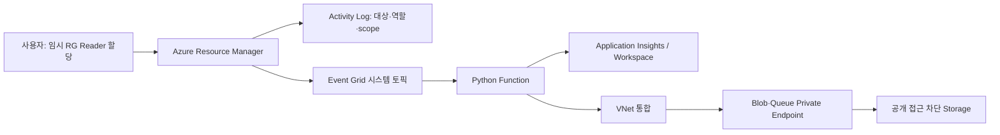

# Azure RBAC 이벤트 모니터링 워크숍

**구독에서 역할을 할당하면 어떤 로그가 남을까요?** 약 110분 동안 Event Grid와 Azure Functions를 연결하고, 실제 임시 Reader 할당을 Activity Log·함수 실행·전달 지표로 대조합니다.

> **실습 환경:** 참가자별 독립 Azure 구독, Azure Public Cloud, Cloud Shell **Bash**.
> 기존 구독 소스의 시스템 토픽이 있으면 실습을 중단합니다. 운영 구독이나 기존 모니터링 구성을 재사용하지 않습니다.

## 실습을 마치면

- RBAC 할당 **대상 사용자**와 요청 **수행자**의 차이를 설명할 수 있습니다.
- 역할 할당 쓰기 성공만 필터링하여 Python Function에서 수신합니다.
- Activity Log의 요청 본문에서 대상 Object ID·Reader 역할·scope를 확인하고, 동일 할당의 수신 및 성공 실행을 대조합니다.
- Storage의 공개·익명·공유 키 접근을 차단한 상태로 코드를 게시합니다.
- 실행 상태를 복구하고, 자신이 만든 역할과 리소스만 확인 후 정리합니다.

**범위는 수신·로그 검증까지입니다.** 사용자 표시 이름·역할명·`companyName`을 Function이 자동 보강하지 않습니다. Microsoft Graph 애플리케이션 권한도 부여하지 않습니다. 표시 이름 없이 Object ID를 대조하는 과정입니다.

Function HTTPS 수신과 모니터링 엔드포인트까지 완전 사설인 구성은 아닙니다.

## 진행 순서

각 장은 **👁️ 설명 → 🟢 실행 → 📋 확인**, 별도 **⚠️ 주의** 순서입니다. 스크린샷 대신 Portal 경로와 실제 확인 항목을 제공합니다.

| 모듈 | 내용 | 시간 |
|---|---|---:|
| [00. Azure RBAC와 이벤트 이해](docs/00-azure-rbac-basics.md) | 대상·수행자, 이벤트 흐름과 지원 범위 | 10분 |
| [01. 실습 준비](docs/01-prerequisites.md) | 권한·비용·도구, 사전 점검과 상태 복구 | 15분 |
| [02. 사설 Storage 인프라](docs/02-private-infrastructure.md) | 전용 RG, what-if, VNet·PE·DNS | 25분 |
| [03. Function 코드 게시](docs/03-function-deployment.md) | 최소 ZIP·Linux 원격 빌드·함수 등록 | 15분 |
| [04. Event Grid 연결](docs/04-event-grid.md) | 쓰기 성공 필터와 Function destination | 10분 |
| [05. 실제 이벤트와 로그 검증](docs/05-rbac-event-validation.md) | 안전한 Reader 실험·KQL·UTC 지표 | 20분 |
| [06. 정리와 운영 전환](docs/06-cleanup-production.md) | 삭제 preview·부재 확인·운영 한계 | 15분 |

처음에는 **[01. 실습 준비](docs/01-prerequisites.md)**의 권한·비용을 검토한 뒤 00부터 진행하세요. 중단했다면 새 실행을 만들지 말고 01의 **상태 복구**를 사용합니다.

## 반드시 먼저 확인

**권한:** 독립 실습 구독의 Owner 또는 동등한 리소스 배포·Event Grid 소스 관리·RBAC 생성/삭제 권한이 필요합니다. **Contributor 단독으로는 부족합니다.** 로그인 사용자만 실험 대상으로 허용하며 다른 사용자를 지정하지 않습니다.

**비용:** Function 실행, Storage, Blob·Queue Private Endpoint 두 개, Private DNS 두 개, Event Grid 및 로그 수집·보존에 비용이 발생할 수 있습니다. 유휴 상태도 무료라고 가정하지 않습니다. 실습 후 06을 반드시 수행합니다. 정확한 금액은 [Azure 가격 계산기](https://azure.microsoft.com/pricing/calculator/)에서 지역·사용량으로 확인합니다.

**안전:** 도구는 기본 구독·로그인 계정을 바꾸지 않습니다. 기존 시스템 토픽·역할을 삭제하거나 정책·공유 키 제한을 우회하지 않습니다. 전용 VNet은 다른 네트워크와 연결하지 않습니다.

## 검증 상태와 한계

기존 PoC는 실제 구독의 역할 할당 → Event Grid → Function 수신과 로그 대조를 검증했습니다. 새 워크숍의 보조 도구는 Azure CLI 경계를 모의 처리한 자동 테스트, Bicep 컴파일, 문서 명령의 구문·안전 인자 검사로 검증합니다. **이 워크숍 전체를 새로 Azure에 재배포하여 검증한 것은 아닙니다.** 과거 관측 예시와 개발 검증 방법은 [개발 안내](docs/development.md)에 구분했습니다.

Event Grid는 중복·역순 전달이 가능하고 로그에는 지연·누락이 있을 수 있습니다. 이 구성은 손실 없는 감사 원장이 아니며, PIM 전체 수명주기·Entra 디렉터리 역할·그룹 구성원 확장은 다루지 않습니다.

## 저장소 안내

| 경로 | 역할 |
|---|---|
| `function_app.py`, `rbac_monitor/` | 이벤트 입력 검증과 구조화된 수신 로그 |
| `infra/` | 구독 배포, 사설 Storage 인프라, 이벤트 연결 |
| `scripts/workshop.py` | 사전 점검·상태·패키징·실험·검증·안전 정리 |
| `tests/` | 클라우드 생성·삭제 없는 자동 테스트 |
| `.workshop-state/` | 로컬 실행 상태·ZIP·증거. Git 및 Function 게시에서 제외 |

교재 구성은 [ms-landing-zone-02](https://github.com/freeman9844/ms-landing-zone-02)의 번호형 핸즈온 진행 방식을 참고했습니다. 설명·코드·다이어그램은 이 실습에 맞게 작성했습니다.
