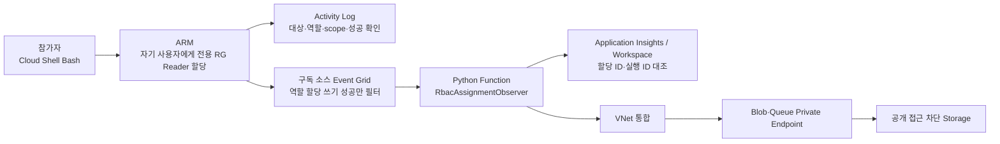

# Azure RBAC 이벤트 모니터링 워크숍

> 약 **110분** 동안 Azure 구독의 RBAC 할당 이벤트를 Event Grid로 필터링하고, 실제 임시 Reader 할당 한 건을 Activity Log·Function·전달 지표로 따라가는 참가자용 핸즈온입니다. **참가자별 독립 교육용 구독과 Owner 또는 동등한 권한**, Azure Public Cloud, **Cloud Shell Bash**를 전제로 합니다. 운영 구독이나 기존 시스템 토픽을 재사용하지 마세요. Private Endpoint·Storage·로그 등에 비용이 발생하므로 **Module 06의 정리와 부재 확인까지** 완료해야 합니다.

**무엇을 확인하나요?** “누가 요청했는가”와 “누구에게 어떤 역할을 주었는가”를 구분하고, 같은 역할 할당 ID가 실제 수신 로그에 나타나는지 확인합니다. 대상 Object ID·Reader 역할·scope는 실습 수행자가 Activity Log 요청 본문과 역할 정의를 대조합니다.

**범위는 이벤트 수신·로그 검증까지입니다.** Function의 사용자 표시 이름·역할명·`companyName` 자동 보강과 Microsoft Graph 애플리케이션 권한 부여는 포함하지 않습니다.

---

## 아키텍처



수신기는 `Microsoft.Resources.ResourceWriteSuccess`와 `data.operationName = Microsoft.Authorization/roleAssignments/write`를 함께 선택합니다. **역할을 생성하고 삭제하는 실험은 자기 사용자·이번 RG의 Reader로 제한**합니다. 삭제 성공은 Activity Log에서 확인하지만 삭제 이벤트를 Function에 전달하는 구성은 아닙니다.

Storage는 VNet·Blob/Queue Private Endpoint·Private DNS를 통해 사용합니다. **Function HTTPS 수신과 모니터링 경로까지 완전 사설인 구성은 아닙니다.**

---

## 학습 목표

이 워크숍을 완료하면 다음을 할 수 있습니다.

1. 역할 할당의 대상인 `principalId`, 역할 정의, 적용 범위와 요청 수행자를 구분한다.
2. 사설 Storage를 사용하는 Function을 배포하고, 코드 게시·함수 등록 후 Event Grid를 연결한다.
3. 실제 임시 Reader 할당을 생성하고 동일 할당 ID와 InvocationId·OperationId로 수신·실행 성공을 대조한다.
4. 이벤트 수신 지연과 로그 수집 지연, 토픽 집계와 개별 이벤트, 표본 없음과 측정값 0을 구별한다.
5. 중단한 실행의 상태를 복구하고 자기 실행의 임시 역할과 유료 자원만 정리한 뒤 부재를 확인한다.

---

## 사전 요구사항

| 항목 | 참가 조건 |
|---|---|
| 실행 환경 | Azure Public Cloud의 **Cloud Shell Bash**. PowerShell 명령과 혼용하지 않음 |
| 구독·권한 | 참가자별 독립 교육용 구독의 **Owner 또는 동등한 배포·Event Grid 관리·RBAC 생성/삭제 권한**. Contributor 단독은 부족 |
| 구독 소스 시스템 토픽 | 기존 토픽이 없어야 함. 충돌하면 기존 토픽을 수정하지 않고 다른 실습 구독 준비 |
| 기본 도구 | `az`, Bicep, `python3` 3.11 이상, `git`. Module 01에서 확인 |
| 지역·정책 | 기본 `koreacentral`. Flex Consumption·사설 네트워크 지원, 공급자 등록과 상속 정책 확인 |
| 상태 보존 | `.workshop-state/`를 비공개로 보관할 저장소. 새 세션에서도 기존 실행을 복구할 수 있어야 함 |
| 비용 승인 | Function·Storage·Private Endpoint·DNS·Event Grid·로그의 과금과 정리 시간을 사전에 승인 |

기본 구독·로그인 계정은 자동 전환하지 않습니다. 조직 정책, Storage 공유 키 제한과 기존 네트워크를 변경해 실습을 우회하지 않습니다. 상세 확인은 [Module 01](docs/01-prerequisites.md)에서 진행합니다.

---

## 모듈 목차

**Module 00 → 06** 순서입니다. Module 05의 실험이 실패하거나 중단되어도 **Module 06은 반드시 수행**합니다. 각 장은 목표·예상 시간·시작 전 상태, 단계별 설명·실행·확인, 트러블슈팅, 완료 체크를 제공합니다.

| # | 모듈 | 참가자가 확인할 결과 |
|---|---|---|
| 00 | [Azure RBAC와 이벤트 이해](docs/00-azure-rbac-basics.md) | 할당 대상·수행자와 로그·지표의 역할 구분 |
| 01 | [사전 요구사항과 상태 복구](docs/01-prerequisites.md) | 권한·정책·도구 점검, 고유 실행 상태와 공통 함수 |
| 02 | [사설 Storage 인프라](docs/02-private-infrastructure.md) | 소유 태그가 있는 RG, what-if, VNet·PE·DNS·Function |
| 03 | [Function 코드 게시](docs/03-function-deployment.md) | 최소 소스 ZIP, Linux 원격 빌드, 실제 함수 등록 |
| 04 | [Event Grid 연결](docs/04-event-grid.md) | 구독 소스·쓰기 성공·작업명 필터·Function destination |
| 05 | [실제 역할 할당과 로그 검증](docs/05-rbac-event-validation.md) | 임시 Reader의 생성·삭제, 같은 할당의 수신·실행 성공 |
| 06 | [회고·정리와 운영 전환](docs/06-cleanup-production.md) | 삭제 preview, 정확한 역할·RG의 부재, 운영 한계 |

세션이 바뀌면 저장소로 돌아와 **기존 상태 파일을 선택**합니다.

```bash
cd event-rbac-test-01
find .workshop-state -maxdepth 1 -type f -name '*.json' -print
```

그다음 [Module 01의 상태 복구](docs/01-prerequisites.md#3-상태-복구와-공통-함수)에서 `STATE_FILE`을 선택하고 공통 함수를 정의합니다. JSON 상태 파일을 `source`·`eval`로 실행하지 않으며, 복구하려고 `init`을 다시 실행하지 않습니다.

---

## 시간표

| 모듈 | 실습 내용 | 예상 시간 |
|---|---|---:|
| 00 | 개념과 이벤트 흐름 | 10분 |
| 01 | 사전 점검·초기화·상태 복구 | 15분 |
| 02 | 인프라 배포와 사설 경로 확인 | 25분 |
| 03 | 코드 게시와 함수 등록 | 15분 |
| 04 | 이벤트 연결과 필터 확인 | 10분 |
| 05 | 실제 이벤트·로그·지표 대조 | 20분 |
| 06 | 결과 회고·전체 정리·부재 확인 | 15분 |
| | **합계** | **110분** |

배포, RBAC 전파, 로그·지표 수집과 삭제 대기에 따라 더 걸릴 수 있습니다. 시간표가 끝났다는 이유로 cleanup 완료 확인을 생략하지 않습니다.

---

## 비용 개요

> 고정 통화 금액이나 무료 실습을 보장하지 않습니다. 구독·지역·실행 시간·사용량에 따라 달라지며, [Azure 가격 계산기](https://azure.microsoft.com/pricing/calculator/)로 사전에 확인합니다.

| 리소스 | 과금 관점 | 실습 후 확인 |
|---|---|---|
| Function Flex Consumption | 실행·메모리 사용량 등 해당 요금제 기준 | 전용 Function과 요금제 삭제 |
| Storage | 저장 용량·트랜잭션 | 배포 패키지·호스트용 계정 삭제 |
| Blob·Queue Private Endpoint 2개 | 시간·데이터 처리량 | 유휴 중에도 과금될 수 있어 둘 다 삭제 |
| Private DNS zone 2개 | 영역과 DNS 쿼리 | 영역·VNet 링크 삭제 |
| Event Grid | 이벤트·전달 등 해당 사용량 | 이번 시스템 토픽·이벤트 구독 삭제 |
| Application Insights / Workspace | 로그 수집·보존 | 전용 모니터링 자원 삭제, 비용 집계 지연 고려 |

삭제 단위는 **이번 실행의 전용 RG와 기록한 임시 역할**입니다. 구독 범위 Reader는 RG 삭제로 없어지지 않습니다. 정상 워크숍 명령은 `assignSubscriptionReader=false`로 해당 권한 생성을 끄지만, 과거 PoC·수동 배포는 정확한 외부 역할 ID까지 별도 확인해야 합니다.

---

## 태그 범례

| 태그 | 읽는 방법 |
|---|---|
| 🟢 **실행** | 참가자가 직접 수행하는 명령 또는 Portal 작업 |
| 👁️ **설명** | 목적·동작·확인할 경계를 이해하기 위한 안내 |
| 📋 **확인** | 예상 출력과 실제 응답·상태를 비교하는 체크포인트 |
| ⚠️ **주의** | 비용·보안·중단 조건·오해하기 쉬운 한계 |

자리 표시자는 자기 상태의 값으로 바꿉니다. 스크린샷을 재현한 가상 이미지는 제공하지 않으며, 각 장의 Portal 경로와 응답 필드로 확인합니다.

---

## 트러블슈팅 색인

| 증상·질문 | 참조 |
|---|---|
| caller와 할당 대상, 삭제 이벤트 감시 범위가 헷갈린다 | [Module 00](docs/00-azure-rbac-basics.md#트러블슈팅) |
| 권한·provider·기존 시스템 토픽 검사 또는 상태 복구가 실패한다 | [Module 01](docs/01-prerequisites.md#트러블슈팅) |
| 정책·PE·DNS 문제로 배포나 출력 보관에 실패한다 | [Module 02](docs/02-private-infrastructure.md#트러블슈팅) |
| Storage 403, 원격 빌드 실패 또는 함수 미등록이 발생한다 | [Module 03](docs/03-function-deployment.md#트러블슈팅) |
| Event Grid source·필터·destination이 예상과 다르다 | [Module 04](docs/04-event-grid.md#트러블슈팅) |
| 수신·실행 로그가 없거나 지표가 null이다 | [Module 05](docs/05-rbac-event-validation.md#트러블슈팅) |
| 부분 실패·외부 Reader·삭제 대기 때문에 정리 여부를 판단하기 어렵다 | [Module 06](docs/06-cleanup-production.md#트러블슈팅) |

---

## 검증 상태와 한계

**2026-11-17 기존 PoC 재테스트:** 실제 역할 할당 성공 후 약 **6.52초**에 Function 수신과 실행 성공을 확인했습니다. 해당 구간 토픽 지표는 매칭 1·전달 성공 1이며, 테스트 RG와 그 내부 17개 자원 및 두 임시 Reader의 삭제·부재도 확인했습니다. [Module 05의 익명화 관측 예시](docs/05-rbac-event-validation.md#4-실제-관측-예시)에서 플로우와 시각을 볼 수 있습니다.

이 결과는 **기존 PoC 경로**의 재검증입니다. **새 워크숍의 전체 Cloud Shell 절차와 `scripts/workshop.py`를 실제 Azure에 재배포하여 검증한 것은 아닙니다.** 보조 도구·문서 명령의 자동 검증과 기존 실측을 구분하며, 개발 검증 범위는 [개발 안내](docs/development.md)에 명시합니다. 이번 문서 개편을 위해 Azure 자원을 추가 생성하지 않습니다.

Event Grid는 중복·역순 전달이 가능하고 로그에는 지연·누락이 있을 수 있습니다. 이 구성은 손실 없는 감사 원장이 아니며, PIM 전체 수명주기·Entra 디렉터리 역할·그룹 구성원 확장은 다루지 않습니다.

## 저장소 안내

| 경로 | 역할 |
|---|---|
| `function_app.py`, `rbac_monitor/` | 이벤트 입력 검증과 구조화된 수신 로그 |
| `infra/` | 구독 배포, 사설 Storage 인프라, 이벤트 연결 |
| `scripts/workshop.py` | 사전 점검·상태·패키징·실험·검증·안전 정리 |
| `tests/` | 클라우드 생성·삭제 없는 자동 테스트 |
| `.workshop-state/` | 로컬 실행 상태·ZIP·증거. Git 및 Function 게시에서 제외 |

## 참고 자료

- [Azure RBAC 역할 할당](https://learn.microsoft.com/azure/role-based-access-control/role-assignments)
- [Azure 구독과 리소스 그룹 Event Grid 이벤트](https://learn.microsoft.com/azure/event-grid/event-schema-resource-groups)
- [Event Grid 시스템 토픽](https://learn.microsoft.com/azure/event-grid/system-topics)
- [Azure Functions Event Grid 트리거](https://learn.microsoft.com/azure/azure-functions/functions-bindings-event-grid-trigger)

이번 문서 개편은 [aci-basic-workshop-01](https://github.com/freeman9844/aci-basic-workshop-01)의 시작 페이지·번호형 모듈·학습 체크포인트 형식을 참고했습니다. 최초 교재 구성은 [ms-landing-zone-02](https://github.com/freeman9844/ms-landing-zone-02)를 참고했으며, 설명·코드·다이어그램은 RBAC 실습에 맞게 작성했습니다.
