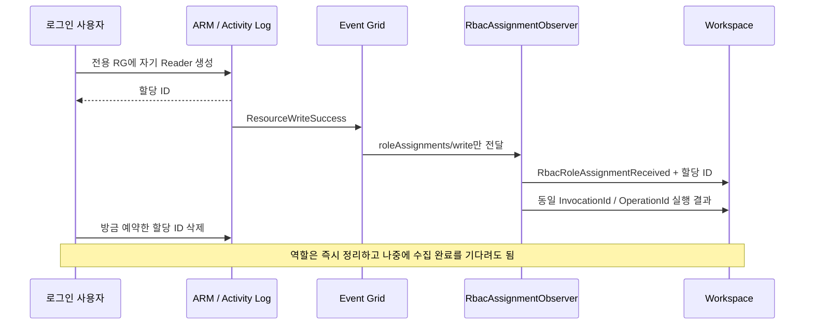

# 00. Azure RBAC와 이벤트 이해

⏱️ **10분** · 목표: 누가 요청했는지와 누구에게 무엇을 할당했는지 구분합니다.

[워크숍 홈](../README.md) · 다음: [01. 실습 준비](01-prerequisites.md)

## 1. 역할 할당을 읽는 방법

👁️ **설명**

역할 할당은 **principal + role definition + scope**의 조합입니다. 이 실습은 로그인한 자기 사용자에게, 새 전용 리소스 그룹의 **Reader**를 잠시 직접 할당합니다.

| 항목 | 의미 | 확인 위치 |
|---|---|---|
| `principalId` | 권한을 받는 대상의 Entra Object ID | Activity Log 쓰기 요청 본문 |
| `roleDefinitionId` | 부여한 역할의 정의 ID | 요청 본문. Reader GUID는 `acdd72a7-3385-48ef-bd42-f606fba81ae7` |
| `scope` | 역할이 적용되는 Azure 리소스 범위 | 역할 할당 리소스 ID의 상위 범위 |
| 수행자·caller·claims | 요청을 수행한 주체 | Activity Log 인증·호출 정보. **할당 대상과 다를 수 있음** |

🟢 **실행**

Portal → **구독 → 선택한 실습 구독 → 액세스 제어(IAM) → 역할 할당**에서 principal·역할·범위가 각각 무엇인지 읽습니다. 아직 역할을 변경하지 않습니다.

📋 **확인**

다른 관리자가 나에게 역할을 주었다면 수행자와 `principalId`는 다릅니다. 이벤트의 claims에서 할당 대상을 추론하지 않습니다. Function의 수신 로그만으로 사용자 표시 이름이나 역할명을 알 수 있는 것은 아닙니다.

⚠️ **주의**

사용자·그룹·서비스 주체의 직접 할당은 소스 범위 안에서 감지할 수 있지만 이 실험 도구는 **자기 사용자**만 허용합니다. 그룹 구성원 확장, Entra 디렉터리 역할, 관리 그룹에서 하위 구독으로 상속된 할당 변화, PIM 전체 수명주기는 별도 설계가 필요합니다.

## 2. 이번 실습의 이벤트 흐름

👁️ **설명**

ARM이 쓰기 성공을 발행하면 구독 소스의 시스템 토픽이 다음 두 조건을 **모두** 적용합니다.

| 필터 | 값 |
|---|---|
| 이벤트 유형 | `Microsoft.Resources.ResourceWriteSuccess` |
| 고급 필터 `data.operationName` | `Microsoft.Authorization/roleAssignments/write` |
| 전달 스키마 | `EventGridSchema` |
| destination | `RbacAssignmentObserver` Azure Function |

🟢 **실행**

다이어그램에서 **대상·역할 확인은 Activity Log**, **수신·실행 확인은 Function 로그**, **토픽 전체 전달 상태는 지표**라는 경계를 찾습니다.

📋 **확인**

삭제 성공은 Activity Log에서 확인하지만 이 필터는 삭제 이벤트를 Function에 전달하지 않습니다. `eventId`와 Activity `correlationId`가 같을 수도 있으나 항상 같다고 가정하지 않습니다.

⚠️ **주의**

구독 소스 하나에는 시스템 토픽 하나만 사용할 수 있습니다. 여러 참가자가 하나의 구독에서 각자 토픽을 만들 수 없습니다. 기존 토픽이 발견되면 다른 독립 실습 구독을 준비하며, 기존 토픽을 변경·삭제하지 않습니다. [공식 시스템 토픽 설명](https://learn.microsoft.com/azure/event-grid/system-topics)을 참고하세요.

## 완료 체크

- [ ] 할당 대상과 요청 수행자를 구분했습니다.
- [ ] 수신 로그가 사용자·역할명 자동 보강 결과가 아님을 이해했습니다.
- [ ] 개인별 독립 실습 구독과 로그·지표의 역할을 확인했습니다.

[홈](../README.md) · 다음: [01. 실습 준비](01-prerequisites.md)
